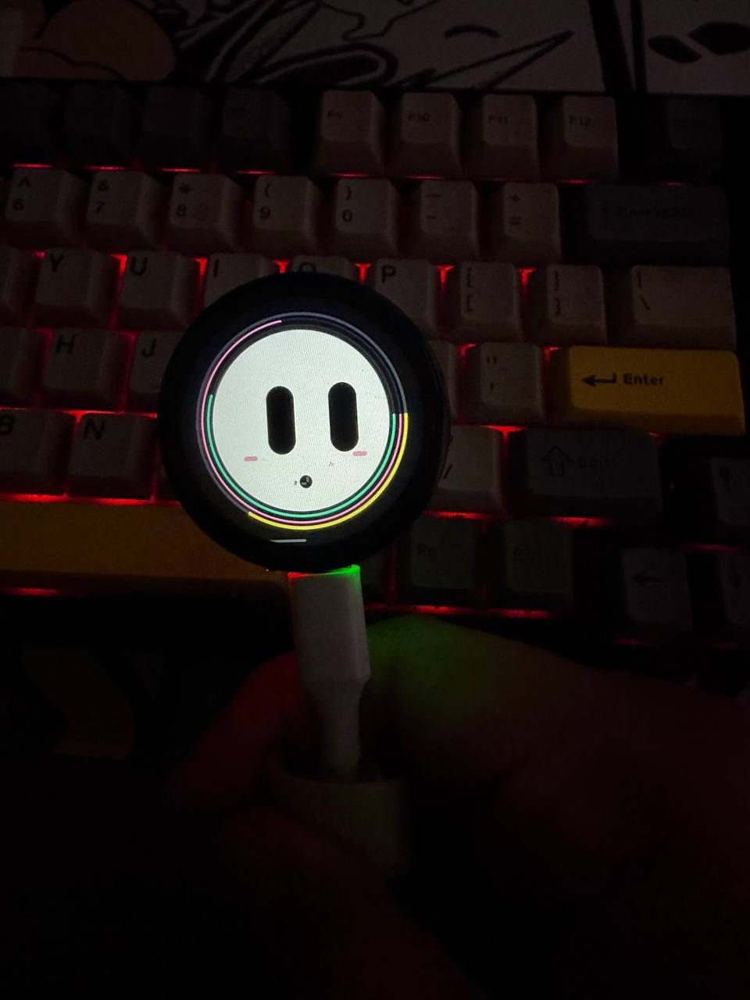

# FUMI

[](https://github.com/imaaiagent/fumi/releases)
[](https://github.com/imaaiagent/fumi/blob/main/LICENSE)
[](https://github.com/imaaiagent/fumi)
[](https://github.com/imaaiagent/fumi/releases)

An open-source AI companion that lives on your desk.


### An open-source AI companion that lives on your desk.

FUMI is a Tamagotchi-inspired physical AI companion built around an ESP32-S3 display board.

It combines:

- animated character UI
- touch interaction
- hunger, energy, happiness, bond, and growth
- a small interactive game
- cloud AI chat
- push-to-talk voice input
- a provider-agnostic AI backend

**FUMI is not locked to one model provider.** The same firmware can talk to a backend configured for OpenAI, Anthropic Claude, xAI Grok, OpenRouter, Ollama, or another compatible API.

> **Development status:** active / experimental. The firmware in this repository is the latest project source provided for this release. Hardware and provider support should be considered tested only where explicitly marked below.

---

## Demo

### What FUMI does

```text
┌──────────────────────┐
│       FUMI           │
│  ESP32-S3 + LVGL     │
│                      │
│  Touch • Life • Voice│
└──────────┬───────────┘
           │ HTTPS
           ▼
┌──────────────────────┐
│     FUMI Backend     │
│                      │
│ /brain     /voice    │
└──────────┬───────────┘
           │
     ┌─────┼──────────────┐
     ▼     ▼              ▼
   OpenAI Claude          Grok
     │     │              │
     └─────┼──────────────┘
           ▼
      OpenRouter
        Ollama
   Compatible APIs
```

### Browser demo

The repository includes `demo/index.html`, which lets you test `/brain` from a browser without the physical device. If device authentication is enabled, enter the same optional device token in the demo.

Run the backend:

```bash
cd backend
cp .env.example .env
# Configure the provider and model in .env
npm run dev
```

Then open `demo/index.html` and enter your backend URL.

**Important:** the browser demo proves the backend path works. It is not a substitute for an end-to-end hardware demo.

### Hardware demo

The repository includes the real prototype demo at `docs/assets/fumi-demo.mp4`.

Do not publish media that exposes passwords, API keys, private SSIDs, or private conversations.

---

### The physical FUMI



[▶ Watch the real FUMI prototype demo](https://youtube.com/shorts/-ibA0lVkqD0?feature=share)

## Supported AI providers

The backend uses an adapter-style provider configuration.

| Provider | Backend setting |
|---|---|
| OpenAI | `LLM_PROVIDER=openai` |
| Anthropic Claude | `LLM_PROVIDER=anthropic` |
| xAI Grok | `LLM_PROVIDER=xai` |
| OpenRouter | `LLM_PROVIDER=openrouter` |
| Ollama | `LLM_PROVIDER=ollama` |
| OpenAI-compatible APIs | `LLM_PROVIDER=openai-compatible` |

Set the model ID supported by your account:

```env
LLM_PROVIDER=anthropic
LLM_MODEL=your-supported-claude-model
```

or:

```env
LLM_PROVIDER=xai
LLM_MODEL=your-supported-grok-model
```

Model names, availability, pricing, and capabilities change over time. Use the model ID currently supported by your provider account.

### Voice architecture

Voice input and text generation are separate.

The reference backend currently uses OpenAI speech-to-text for `/voice`, then sends the transcript to the selected text model.

For example:

```text
FUMI microphone
      │
      ▼
   WAV upload
      │
      ▼
speech-to-text
      │
      ▼
 transcript
      │
      ▼
selected text model
      │
      ▼
 FUMI response
```

This means you can use Claude or Grok for FUMI's personality/answer while using a separate speech provider.

---

## Repository structure

```text
FUMI/
├── firmware/
├── backend/
├── demo/
├── docs/
│   └── assets/
├── scripts/
├── .github/
├── CONTRIBUTING.md
├── SECURITY.md
├── CHANGELOG.md
├── LICENSE
└── README.md
```

---

## Firmware setup

The firmware requires the upstream Waveshare driver files and the libraries shipped with its Arduino example. Run the dependency setup script first; it fetches the official source and generates the local Arduino sketch folder. Install any bundled libraries listed by the upstream example into your Arduino libraries folder before compiling.

Windows PowerShell:

```powershell
powershell -ExecutionPolicy Bypass -File .\\scripts\\setup-waveshare.ps1
```

macOS / Linux:

```bash
bash scripts/setup-waveshare.sh
```

Then open `firmware/build/LVGL_Arduino/LVGL_Arduino.ino` in Arduino IDE. Edit the generated local file `firmware/build/LVGL_Arduino/fumi_config.h` with your Wi-Fi credentials and backend URLs.


### Arduino IDE

Recommended development baseline:

- Arduino IDE 2.3.10
- ESP32 by Espressif Systems 3.3.12
- Board: `ESP32S3 Dev Module`
- CPU: `240MHz (WiFi)`
- Flash Mode: `QIO 80MHz`
- Flash Size: `16MB (128Mb)`
- Partition Scheme: `Huge APP (3MB No OTA/1MB SPIFFS)`
- PSRAM: `OPI PSRAM`
- Arduino Runs On: `Core 1`
- Events Run On: `Core 1`
- USB Mode: `Hardware CDC and JTAG`
- Upload Mode: `UART0 / Hardware CDC`
- USB CDC On Boot: `Disabled`

### Configuration

Copy:

```text
firmware/fumi_config.h.example
```

to:

```text
firmware/fumi_config.h
```

Then fill in:

```cpp
#define FUMI_WIFI_SSID_CONFIG "YOUR_WIFI_SSID"
#define FUMI_WIFI_PASSWORD_CONFIG "YOUR_WIFI_PASSWORD"
#define FUMI_BRAIN_URL_CONFIG "https://your-backend/brain"
#define FUMI_VOICE_URL_CONFIG "https://your-backend/voice"
```

`fumi_config.h` is ignored by Git.

---

## Backend

Requires Node.js 20.6+.

```bash
cd backend
cp .env.example .env
npm install
npm run check
npm test
npm run dev
```

Health:

```bash
curl http://localhost:8787/health
```

Chat:

```bash
curl -X POST http://localhost:8787/brain   -H "Content-Type: application/json"   -d '{"message":"Hey FUMI, introduce yourself."}'
```

The backend preserves FUMI's original state-event contract (`event`, `hunger`, `happiness`, `energy`, `bond`, `affection`, `playfulness`, `sleeping`, `expression`, and `age_seconds`) and returns `action`, `expression`, and `message`. The same `/brain` route also supports a plain `message` for the browser demo. The backend returns a simple contract that the firmware can consume:

```json
{
  "ok": true,
  "reply": "Hello!",
  "action": "talk",
  "expression": "normal",
  "provider": "openai",
  "model": "your-model"
}
```

---

## Security

**Never put model-provider API keys in the ESP32 firmware.**

The intended architecture is:

```text
ESP32
  │
  │ device request
  ▼
Your backend
  │
  │ provider API key stays here
  ▼
AI provider
```

Before exposing a backend publicly, add authentication/device pairing, rate limiting, usage limits, and restrictive CORS.

See `SECURITY.md`.

---

## Project status

FUMI is presented as a complete open-source reference build in this repository:

- animated FUMI UI
- touch interaction
- hunger, energy, happiness, bond, and growth
- mini-game
- Wi-Fi AI backend
- push-to-talk voice pipeline
- selectable text-model providers
- backend device authentication
- multiple speech-to-text provider adapters
- local model support through Ollama / OpenAI-compatible endpoints
- GitHub release automation
- documented Waveshare dependency manifest
- public demo assets and release documentation

Hardware demos and dependency files in this repository should always match the actual hardware build being released.

## License

MIT. See `LICENSE`.

FUMI is an independent open-source project and is not affiliated with or endorsed by OpenAI, Anthropic, xAI, OpenRouter, Ollama, or Waveshare.
